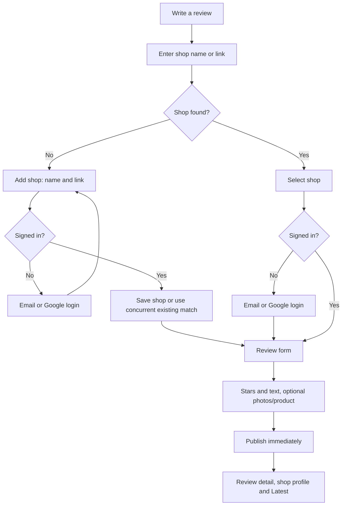

# 01 - Product and UX

Status: specification complete on 2026-11-22. The implementation acceptance checks below remain pending until tasks 03-10 deliver working software.

## Purpose

Help people in Tunisia decide where to buy by reading and publishing experiences about shops selling through Instagram, Facebook and websites.

## Agreed rules

- Guests browse shops, reviews and feed. Active signed-in users publish, like, comment and report.
- Any account can review any shop. Multiple reviews per user/shop are allowed; representatives have no special restriction.
- No email verification, receipt, ownership claim or pre-publication admin approval is required.
- Reviews and comments publish immediately. Admins handle moderation afterward.
- Shop creation requires only a name and one page/website link; other fields are optional.
- Review requires shop, integer rating 1-5 and text. Product name, purchase date and photos are optional.
- Users edit/delete their own reviews and comments. Admins hide/remove content and manage accounts.
- Feed entries are reviews; comments are unstarred replies underneath them.

## Core journey

1. Enter a name, handle or shop link.
2. Select an existing result and immediately open the review form.
3. When no result exists, offer Add shop, prefilled with known input. Save name and link, then return directly to the review form.
4. Enter stars/text, optionally add photos or product name, and publish.
5. Show the published review and shop. The same review is available in Latest.

If authentication is needed, retain the search input, selected shop and draft, then resume after email/password or Google login. A canceled login must not destroy the draft.

## Screens and navigation

Main mobile destinations: Feed, Search, Write a review, Profile. Review composition is a focused flow; web adapts navigation to available width.

Screens: Latest/Trending feed, search/results, add shop, shop profile, review composer, review detail/comments/photos, login/register/recovery, profile/my reviews, account settings and admin screens. Include loading, empty, retry, offline and permission-denied states.

Shop profiles show name, links, optional details, average stars, visible-review count, star histogram, review filters and Write a review. No reviews means "No reviews yet", not zero stars.

## Scope boundaries

Include likes, flat comments, sharing, reporting, admin moderation, French/Arabic and RTL. Defer saved shops, threaded replies, official business ownership/replies, verification badges, social-review imports, structured product catalogs, AI summaries, notifications and payments.

## Acceptance

These are runtime acceptance criteria, not completed features.

- [ ] A new account can immediately publish without additional verification.
- [ ] Existing and missing shops both lead to publication without re-entering context.
- [ ] Multiple reviews for the same shop are accepted.
- [ ] Public feed, detail and shop views represent the same review record.
- [ ] No report or routine edit places content into a mandatory approval queue.

## Screen and route contract

Routes below are proposed Expo Router URLs. Route groups can organize layouts without changing public URLs. UUIDs identify shops/reviews; names and slugs are presentation details so renaming a shop does not break shared links.

| Route | Access | Primary action and behavior |
| --- | --- | --- |
| `/` | Public | Feed defaults to Latest; switch to Trending, open review/shop |
| `/search?q=...` | Public | Search by name/handle/link, select result or add shop |
| `/shops/:shopId` | Public | Read rating/reviews and start writing for this shop |
| `/shops/new` | Signed in | Add name and link, then continue to composer |
| `/reviews/new` | Signed in | Shop selection if missing; stars/text/photos then Publish |
| `/reviews/:reviewId` | Public | Read full review/comments/photos, engage/share/report |
| `/reviews/:reviewId/edit` | Author | Edit the existing review, keeping its original publication date |
| `/login`, `/register` | Public | Email/password or Continue with Google; resume interrupted action |
| `/forgot-password`, `/reset-password` | Public | Request reset, then consume the reset link |
| `/profile` | Signed in | My reviews and profile settings; guests see sign-in action |
| `/settings` | Signed in | Language, account details, logout and account deletion |
| `/admin/*` | ADMIN | Reports, content, shops and users; desktop-adapted web screens |

The Write a review destination opens a composer workflow, not a blank feed tab. Opening it without a selected shop begins at shop search. Admin navigation stays outside the normal consumer tabs.

## Review flow and draft state

Draft state contains a local draft ID, search input, selected shop ID if any, pending shop name/link, stars, text, product name, optional purchase date, selected photo references and a publish submission ID. Keep it separate from server query caches and never store authentication credentials in it.

Persist text/selection locally so navigation or sign-in does not erase it. Mobile photo references may become inaccessible after restart; show a reselect message while retaining text. Clear the draft after confirmed publication or explicit discard, and clear user-associated drafts on logout/account change to avoid exposing them on shared devices. Authentication redirects accept only app-owned destinations, not arbitrary external return URLs.

If a session expires during submission, retain the draft, sign in and retry with the same submission ID. Prevent repeated button taps while a request is pending. A network retry must not create an accidental second review; a new deliberate review gets a fresh ID.

## Form contract

These limits are coding defaults and can be tuned without changing the journey.

| Field | Validation and interaction |
| --- | --- |
| Shop name | Required, trim outside whitespace, 1-150 characters, preserve Unicode/case for display |
| Shop link | Required, at least one usable Instagram/Facebook shop page or http/https website link; no metadata fetch needed |
| Stars | Required, integer 1-5; accessible labels and keyboard/touch selection |
| Experience | Required, trim outside whitespace, 10-5000 characters; explain inline before submission |
| Product name | Optional, up to 150 characters; free text, no catalog setup |
| Purchase date | Optional local calendar date, not a future date |
| Photos | Optional, up to five; proposed 10 MB source limit each with compression/conversion; preview/remove/retry individually |
| Comment | Required when commenting, 1-2000 characters after trimming; flat replies without a star rating |
| Report | Required target and reason; optional details up to 2000 characters |

Report reasons: spam, abusive content, misleading content, wrong shop, duplicate shop, other. A report is a private moderation request, not a public scam label. No form asks for a receipt, shop ownership, email verification or representative status.

## Interaction and visibility decisions

- Shop profile Write a review preselects the shop. Search result selection in review mode goes directly to its composer; ordinary browsing opens the profile.
- Guest engagement opens sign-in with action context. After login, return to that review and let the user finish their like/comment/report; do not silently repeat ambiguous mutations.
- Publication success opens the new review and offers View shop. The same server ID is used by Latest, shop lists and shared links.
- Like is a toggle with one stored like per user/review. Comments are flat and paginated, oldest first with an ID tie-breaker. The review author can like/comment; their own activity is excluded from Trending.
- Editing preserves publication order. Author deletion asks for confirmation and removes the review from public surfaces. Photos/comments inherit parent visibility.
- An admin-hidden review stays hidden if its author edits it. Only an admin can restore it; a removed author review cannot be restored by an ordinary update.
- Reporting never automatically hides content. A visible review can be negative without being a policy violation.
- A hidden/missing public review or shop shows a neutral unavailable state. Authors can see their own hidden review and its moderation state from My reviews; other visitors cannot read it.
- Multiple reviews of a shop from one account are intentional and count as separate reviews. No purchase verification badge or automatic scam verdict is shown.

## Required screen states

| Surface | States to implement |
| --- | --- |
| Search | Initial guidance, loading, matches, no matches with Add shop, invalid link, retry |
| Shop | Loading, no reviews, populated/filter empty, hidden/unavailable, merged redirect |
| Composer | Draft, field errors, uploading, upload failed/reselect, publishing, auth expired, publish retry, success |
| Feed | Latest, Trending, initial loading, pagination, no reviews/no trending activity, retry |
| Review | Detail, no comments, comment submission, reported confirmation, author edit/delete, hidden/unavailable |
| Auth | Ready, in progress, Google canceled, provider/network failure, local-account linking, signed in |
| Admin | Empty/populated report list, action confirmation, stale target, permission denied, action result |

For a failed optional photo upload, offer Retry or Remove and publish without it. Never imply a photo is attached unless the server confirms the ready media asset. Arabic uses mirrored navigation/directional icons; URLs, handles and star values retain an understandable reading direction.

## Implementation scenarios

| ID | Given / action | Expected result |
| --- | --- | --- |
| UX-01 | Guest searches a known shop | Public profile/reviews are readable without sign-in |
| UX-02 | Signed-in new account selects known shop | Composer opens directly; Publish needs no verification |
| UX-03 | Missing shop entered by link | Name/link form preserves input; save continues directly to composer |
| UX-04 | Guest starts add shop and cancels Google login | Draft and pending shop input survive; no shop/review is published |
| UX-05 | Author already reviewed this shop | A second deliberate review can publish |
| UX-06 | Publication times out and is retried | One review is created for that submission ID |
| UX-07 | Review published | Same review appears on profile, detail and Latest |
| UX-08 | Another member reports a review | It remains public until an admin acts |
| UX-09 | Admin hides a review, author edits it | It stays hidden and excluded from public ratings/feed |
| UX-10 | Native photo permission is denied | User can still publish text/stars and see a useful explanation |
| UX-11 | An Arabic user opens the flow | RTL and keyboard layout work; user content is not translated or restricted |

## Task 01 deliverables

- [x] Product scope and the user's low-friction publishing rules recorded.
- [x] Screens, route purposes, draft transitions and error/empty states specified.
- [x] Form defaults and moderation/engagement interactions defined.
- [x] Runtime acceptance scenarios identified for later implementation.

Completion here means the product/UX specification is ready for coding. No rendered screens or runtime acceptance tests exist yet.
