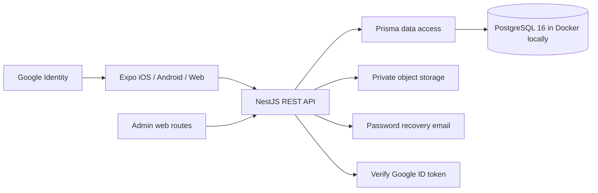
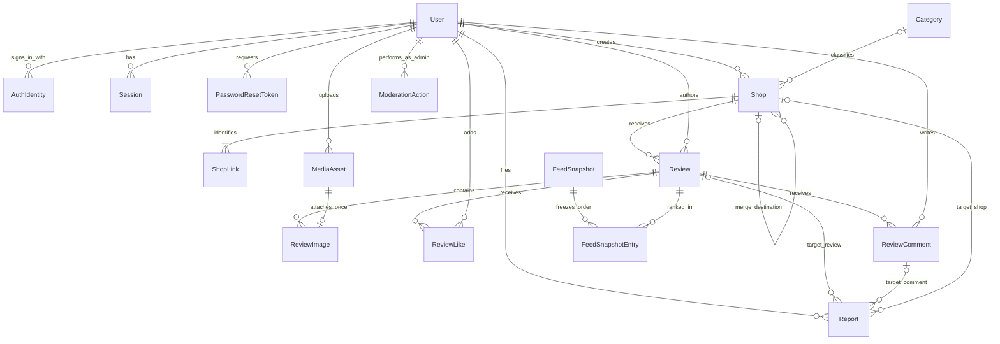

# 02 - Architecture and data conception

Status: design complete on 2026-11-22. This is the target model for task 03; the live Prisma schema still contains CloudOps models. Database concurrency and service behavior remain unverified until implemented.

## Architecture

Expo/React Native/TypeScript (iOS, Android, web) calls one NestJS REST API. Prisma accesses PostgreSQL. Object storage holds photos; an email provider handles password recovery. Start as a modular monolith. Redis, queues, microservices and external search are not initial requirements.

Local PostgreSQL runs in Docker Compose, as requested. NestJS and Expo run on the host during initial development. See [Docker database setup](12-docker-database.md) for commands, ports and volume behavior.

Backend modules: auth, users, shops, categories, reviews, media, feed, engagement, reports, moderation, prisma and health. Frontend uses Expo Router, feature modules, shared UI tokens, an API client and query caching; choose compatible package versions when scaffolding.

## Target entities

| Entity | Fields / relationships |
| --- | --- |
| User | UUID, normalized unique email, nullable passwordHash, display name, avatar, USER/ADMIN role, active flag, locale, timestamps |
| AuthIdentity | User, provider GOOGLE, providerSubject; unique(provider, providerSubject) |
| Session | User, hashed refresh token, expiry, revocation, token-family metadata |
| PasswordResetToken | User, token hash, expiry, consumed timestamp |
| Shop | UUID, name, unique slug, optional description/category/governorate/logo, creator, ACTIVE/HIDDEN/MERGED status, mergedIntoId, timestamps |
| ShopLink | Shop, platform, original URL, canonical identity key, normalized URL, optional handle; canonical identity key unique |
| Category | Key and French/Arabic labels |
| Review | User, shop, rating, text, optional productName/purchaseDate, PUBLISHED/HIDDEN/DELETED status, timestamps |
| MediaAsset | Uploader, storage key, detected MIME, byte size, dimensions, processing status, timestamps |
| ReviewImage | Review, media asset, display order; unique asset attachment |
| ReviewLike | User, review, createdAt; unique(userId, reviewId) |
| ReviewComment | User, review, text, PUBLISHED/HIDDEN/DELETED status, timestamps |
| Report | Reporter, exactly one review/comment/shop target, reason, optional details, OPEN/RESOLVED/DISMISSED status, resolution metadata |
| ModerationAction | Acting admin, target ID/type, action, reason, timestamp and relevant before/after state |
| FeedSnapshot | Short-lived immutable Trending ranking: creation/expiry and algorithm version |
| FeedSnapshotEntry | Snapshot, review, rank and score; unique(snapshotId, rank) and unique(snapshotId, reviewId) |

Implement exactly-one report target with nullable foreign keys plus a PostgreSQL CHECK constraint, rather than an unconstrained arbitrary target ID. Keep moderation references usable after soft deletion.

## Constraints and indexes

- Enforce integer rating range with validation and a database CHECK constraint.
- Do not create a unique(userId, shopId) constraint on Review.
- Use foreign keys and database uniqueness to resolve concurrent duplicate shop creation and repeated likes.
- Index reviews by (status, createdAt, id), (shopId, status, createdAt, id), and author; comments by (reviewId, status, createdAt, id).
- Index normalized shop identity for exact lookup. Add measured name-search indexes (such as pg_trgm) when implementing search; retain Unicode display names.
- Index session/reset hashes and expiry, open reports, and recent engagement used by Trending.
- Dates are stored in UTC; localize display. Prices are deferred unless needed; any later monetary fields use explicit currency and decimal/minor-unit storage.

## Visibility and ratings

Only published reviews under active shops contribute to public lists and rating summaries. Hidden/deleted parents suppress their comments and media access. Private administrative queries explicitly opt into hidden content.

Start with database aggregates for count, average and histogram. If cached counters become necessary, update them transactionally for create/edit/delete/hide/restore and shop merge. Repeated reviews count separately under the agreed policy. Calculate distinct engaged users separately for Trending.

## File access

Use a private bucket and API-authorized or short-lived signed reads. Public review media can be delivered to guests after a visibility check. Do not persist expiring signed URLs as permanent asset identities. Retired media URLs expire quickly; document cache lifetime and invalidate derived thumbnails when hiding content.

## Acceptance

- [x] Diagram/model review matches the product rules and Google-only accounts: see the relationships, data dictionary and rule traceability below.
- [ ] Database constraints survive concurrent requests.
- [ ] Visibility is applied consistently to ratings, search, feed, comments and media.

## Module ownership

| Module | Owns | Collaborates with |
| --- | --- | --- |
| auth | Provider identities, sessions, reset tokens, login/linking | users, prisma |
| users | Safe profiles, roles, account lifecycle | auth for session revocation |
| shops | Shops, link normalization, category assignment, duplicate resolution | reviews for rating reads |
| categories | Small translated classification list | shops |
| reviews | Review mutations, author checks, publication idempotency, rating queries | shops, media |
| media | Upload intents, validation, storage keys, derived images, delivery authorization | reviews for attachment visibility |
| engagement | Likes and flat comments | reviews for parent visibility |
| feed | Latest queries, Trending calculation and snapshots | reviews, engagement |
| reports | Reports and resolution | moderation |
| moderation | Admin actions, audit, hide/restore, merge orchestration, suspension | shops, reviews, engagement, users, auth |

Controllers validate and delegate. Services enforce permissions and invariants even when invoked outside their original HTTP controller. Shared visibility predicates and transaction helpers prevent each module from inventing a different definition of public content. Avoid circular module dependencies by passing visibility/attachment decisions through focused query services or a transaction coordinator.

## Entity relationships

Each Report references exactly one target, despite the diagram showing its three possible relationships. Every created shop must have at least one link, enforced in its creation transaction. A merged shop retains its row and redirects to its destination; it may have no remaining direct links after they move.

## Concrete data contract

[The data dictionary](design/data-dictionary.md) defines field types, nullability, defaults, indexes and lifecycle decisions. Use those definitions when writing Prisma and forward SQL migrations in task 03. It is a design artifact, not an alternative executable schema.

Additional persistence decisions:

- Review stores a required `submissionId` and `submissionHash`, unique by (authorId, submissionId). Retry with an identical payload returns the original review; reusing the key with different content returns a conflict. A deliberate additional review uses a fresh key. Keep the original hash immutable through edits.
- Session represents one refresh-token generation. Retain consumed generations until their family's expiry so reuse can revoke the family. Rotation consumes the old row and creates the successor in one transaction; the active-user check still applies to access tokens.
- FeedSnapshot entries store rank/score, not copied review text. They freeze ordering for a proposed five-minute cursor lifetime, but every page rechecks current visibility. Missing hidden entries are skipped and scanning continues; an expired snapshot returns a stable cursor-expired error so the app can restart the feed.
- Store purchaseDate as a nullable calendar DATE, not a UTC instant. Store creation/expiry timestamps as UTC timezone-aware instants. Round ratings for display only; calculate from underlying integer scores.

## State and visibility matrix

| State / operation | Public behavior | Permitted change |
| --- | --- | --- |
| Shop ACTIVE | Searchable; published reviews readable/countable | Admin corrects, hides or merges |
| Shop HIDDEN | Shop, reviews, comments and media unavailable | Admin restores; child states unchanged |
| Shop MERGED | Resolve old ID to destination before public reads/writes | No ordinary edits/new child writes on old row |
| Review PUBLISHED under active shop | Visible and counted in rating/feed | Author edits/deletes; admin hides |
| Review HIDDEN | Excluded everywhere publicly; author/admin can inspect | Author may edit while hidden; only admin restores |
| Review DELETED | Not public; author cannot recover via PATCH | Terminal in consumer flow; later purge follows retention policy |
| Comment PUBLISHED under visible review | Public and counted | Author edits/deletes; admin hides |
| Comment HIDDEN/DELETED | Not public or counted for engagement | Admin restores HIDDEN only; DELETED is terminal |
| Report OPEN/RESOLVED/DISMISSED | Never public; no automatic visibility change | Admin resolves/dismisses with reason |
| User suspended | Protected actions and sessions rejected | Existing content retains its own visibility; admin reactivates account |

Eligibility for public review content is `review.status = PUBLISHED AND shop.status = ACTIVE`. Public comments additionally require `comment.status = PUBLISHED`. Public media must be READY and attached to a public review. A logo/avatar must use an explicit public profile attachment policy rather than leaking an arbitrary upload by ID.

Counts of visible likes/comments describe current public engagement. Trending additionally excludes the review author's own engagement and inactive users and applies the time windows in task 07. Existing published content from suspended authors remains visible unless separately moderated, matching task 08.

## Transaction and concurrency design

| Operation | Atomic work / race resolution |
| --- | --- |
| Google sign-in | Resolve provider subject; create user/identity together; uniqueness winner is re-read; never merge by email |
| Refresh | Lock/conditionally consume one token generation; create successor; reject reuse and revoke family |
| Create shop | Create shop and at least one unique canonical link together; duplicate key rolls back loser and returns existing match |
| Publish review | Resolve active canonical shop, claim submission ID, validate/claim owned READY media and create ordered attachments together |
| Attach media | Unique mediaAssetId plus ownership/READY check; coordinate with orphan cleanup so an attached image is never purged |
| Like/unlike | Unique pair and idempotent insert/delete; exclude hidden parents |
| Hide/restore | Content state plus ModerationAction in one transaction; aggregates read current rows |
| Merge shops | Lock both in stable ID order; reject cycles; move links/reviews and retain redirect; append audit; aggregate destination reviews |
| Suspend account | Deactivate user, revoke all refresh families and append audit atomically |

Operations racing with hide/merge must coordinate on parent rows or use appropriate conditional writes/isolation. A preflight controller lookup alone is insufficient. Ratings are initially computed rather than cached; invalidation of client responses still happens after commit.

## Rule traceability and verification handoff

| Product rule | Design decision | Future verification |
| --- | --- | --- |
| Any signed-in user reviews repeatedly | No author/shop uniqueness or verification field gate | UX-02, UX-05; task 06 integration tests |
| Immediate publishing | Review/comment default PUBLISHED | UX-07, UX-08; task 06/08 |
| Google and local accounts | Nullable passwordHash, unique provider subject, authenticated linking | Task 04 auth tests |
| Same review in feed/profile | One Review entity; feed references it | UX-07; task 07 |
| Moderation afterward | Visibility state separate from reports | UX-08, UX-09; task 08 |
| Preserve data | Forward migrations; soft deletion/redirects | Task 03 migration tests |
| Stable Trending pagination | Expiring rank snapshots, current visibility checks | Task 07 pagination tests |

## Task 02 deliverables

- [x] Runtime topology, module ownership and entity relationships specified.
- [x] Fields, constraints, indexes, media access and transaction boundaries specified.
- [x] Google-only accounts, repeated reviews, feed identity and admin visibility checked against task 01.
- [x] Docker selected for local PostgreSQL; executable setup documented separately.
- [ ] Task 03 Prisma/SQL implementation and database concurrency checks completed.

This task completes conception. It does not apply Vero tables, install frontend dependencies or implement API routes.
